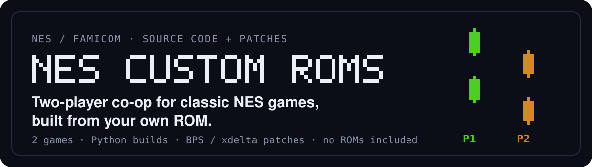

[English](README.md) | **Polski**

<p align="center">
  
</p>

<p align="center">
  <a href="#gry">Gry</a> ·
  <a href="#szybki-start">Szybki start</a> ·
  <a href="#budowanie-i-testy">Budowanie i testy</a> ·
  <a href="#struktura-projektu">Struktura</a> ·
  <a href="#prawa-i-autorzy">Prawa i autorzy</a>
</p>

**NES Custom ROMs** zbiera nieoficjalne projekty, dzięki którym **dwóch graczy gra jednocześnie**
w klasyczne gry NES/Famicom: autorską modyfikację kooperacyjną *Galaxiana* oraz powtarzalne budowanie
istniejącego hacka kooperacyjnego *Super Mario Bros.* Repozytorium zawiera kod źródłowy, skrypty budujące,
testy i łatki (cudze wyraźnie oznaczone) – nigdy samych gier. Buduje się z własnego, legalnie uzyskanego ROM-u.

## Gry

| Galaxian Coop | [Super Mario Bros. Two Players Hack – zestaw do budowania](games/super-mario-coop/README_PL.md) |
|---|---|
| *Kod, zrzuty i README na gałęzi `game/galaxian-coop`.* |  |
| Nowy silnik kooperacji dla *Galaxiana* (Japonia), autor Zvgelo: drugi statek, poziomy broni, 12-sekundowy Red Laser Overdrive z kontratakiem wrogów, tarcza po odrodzeniu, dzielenie się życiami. Te same zasady dla jednego pilota. | Budowanie jednym poleceniem, z kontrolą sum, hacka *Super Mario Bros. Two Players Hack* – **autorzy hacka: Corpse Grinder i Ti (2018)**; oryginalna łatka jest dołączona z podaniem autorów (nie na licencji MIT), a ROM pozostaje niezmieniony. |
| Mapper 0 · łatka BPS w repozytorium · RC6 | Mapper 24 (VRC6a) · oryginalna `.xdelta` hacka |

Każdy projekt jest rozwijany na osobnej gałęzi (`game/galaxian-coop`, `game/super-mario-coop`); ta gałąź
zawiera tylko zestaw do budowania Mario. Każde README opisuje sterowanie, zrzuty ekranu i rozwiązywanie
problemów.

## Najważniejsze cechy

- **Dwóch graczy naraz** na jednym ekranie, każdy z własnym kontrolerem.
- **Zwykłe emulatory**: łatany jest ROM, nie emulator; wynik to zwykły plik NES z mapperem 24.
- **Powtarzalne budowanie**: każde wejście i wyjście jest sprawdzane przez SHA-256; dwa buildy dają te same
  bajty.
- **Bez zależności**: dekoder xdelta/VCDIFF w czystym Pythonie nakłada łatkę hacka (`xdelta3` opcjonalnie).
- **Testy w emulatorze**: rdzeń FCEUmm przez `stable-retro` – zob.
  [docs/TESTING.md](games/super-mario-coop/docs/TESTING.md) (po angielsku).

## Szybki start

Zbuduj Two Players Hack z własnego ROM-u i dołączonej oryginalnej łatki (Python 3, z katalogu głównego):

```bash
mkdir -p games/super-mario-coop/private
cp "Super Mario Bros. (World).nes" games/super-mario-coop/private/original.nes
python3 games/super-mario-coop/src/build.py
sha256sum "games/super-mario-coop/build/Super Mario Bros. (Two Players Hack).nes"
# e962eee2c23449070ebd599357570cfc9da9586e21f142596f49b1eb8c691dd4
```

Otwórz wynik w emulatorze NES z obsługą mappera 24. Sumy kontrolne, inne narzędzia i oryginalne wydanie
autorów: [README](games/super-mario-coop/README_PL.md#jak-uzyskać-grę).

## Budowanie i testy

```bash
pip install -r games/super-mario-coop/tests/requirements.txt    # stable-retro, numpy (testy w emulatorze)
python3 games/super-mario-coop/tests/test_build.py -v           # 16 testów, w tym 2 w rdzeniu FCEUmm
```

Budowanie wymaga tylko Pythona 3 (testowane 3.14, Linux). Wyniki:
[games/super-mario-coop/docs/TESTING.md](games/super-mario-coop/docs/TESTING.md) – wszystkie zaliczone.

## Struktura projektu

```text
nes-custom-roms/
├── README.md               opis po angielsku (ta strona: README_PL.md)
├── LICENSE                 licencja MIT – własne materiały projektu
├── THIRD_PARTY_NOTICES.md  czego licencja MIT nie obejmuje
├── assets/readme/          grafika README
├── tools/                  wspólne narzędzia (na tej gałęzi: dekoder VCDIFF)
└── games/
    └── <gra>/
        ├── README.md       zasady, instalacja, sterowanie, zrzuty (+ README_PL.md)
        ├── assets/         zrzuty ekranu (i grafika README)
        ├── src/            kod źródłowy i build.py
        ├── docs/           CHANGELOG, TESTING i dokumentacja techniczna
        ├── tests/          testy automatyczne
        ├── patches/        oryginalna łatka hacka (cudza, zob. THIRD_PARTY_NOTICES)
        ├── private/        Twoje oryginalne ROM-y                (ignorowane przez git)
        └── build/          wygenerowane ROM-y i pliki wynikowe   (ignorowane przez git)
```

## Prawa i autorzy

- **Licencja**: własny kod, narzędzia, testy, dokumentacja i grafika projektu są udostępnione na
  [licencji MIT](LICENSE) © 2026 Zvgelo. Licencja **nie** obejmuje oryginalnych gier, ROM-ów ani ich
  zasobów, Super Mario Bros. Two Players Hack ani jego oryginalnej łatki (dołączonej z podaniem autorów,
  bez domniemanej zgody na redystrybucję), ani innych materiałów osób trzecich – zob.
  [THIRD_PARTY_NOTICES.md](THIRD_PARTY_NOTICES.md) (po angielsku).
- **Nieoficjalny projekt fanowski.** Niepowiązany z Bandai Namco, Nintendo ani autorami Two Players Hack
  i nieautoryzowany przez nich. *Galaxian* © Namco (1979, NES/Famicom 1984); *Super Mario Bros.* ©
  Nintendo (1985). Nazwy gier i znaki towarowe należą do ich właścicieli.
- **Brak ROM-ów** – oryginalnych i zmodyfikowanych – w repozytorium i w linkach; `*.nes`, `private/`
  i `build/` są wykluczone w `.gitignore`. Potrzebna jest własna, legalnie uzyskana kopia każdej gry.
- **Autorzy**: *Super Mario Bros. – Two Players Hack*: oryginalny hack **Corpse Grinder & Ti** (2018).
  *Galaxian Coop*, narzędzia, testy i dokumentacja: **Zvgelo** (2026).
