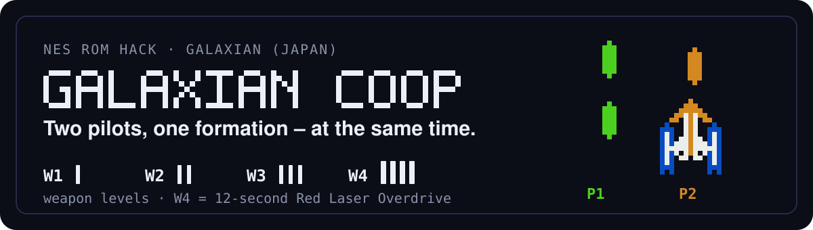
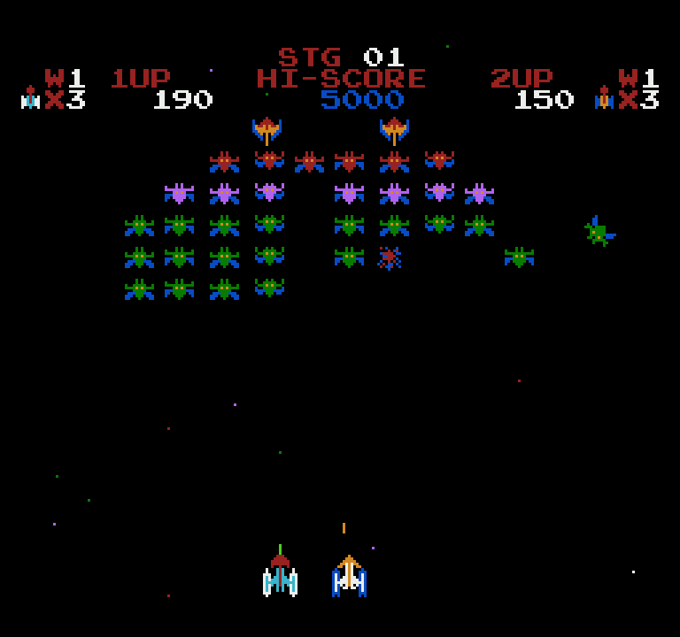
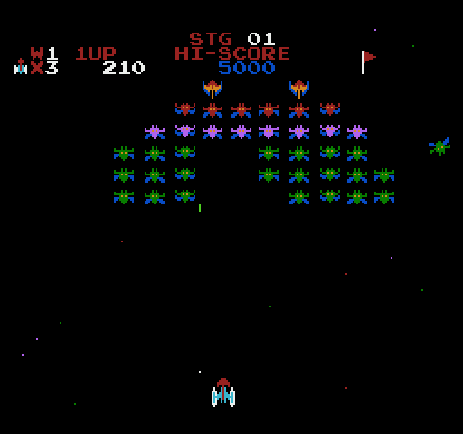
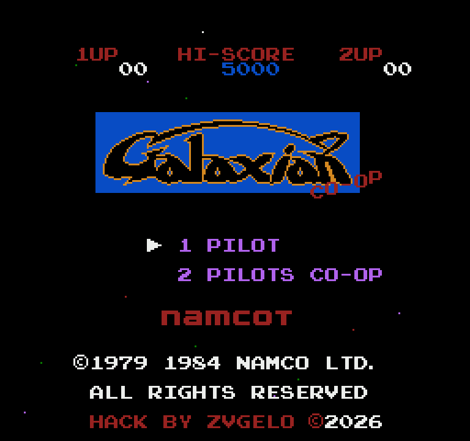
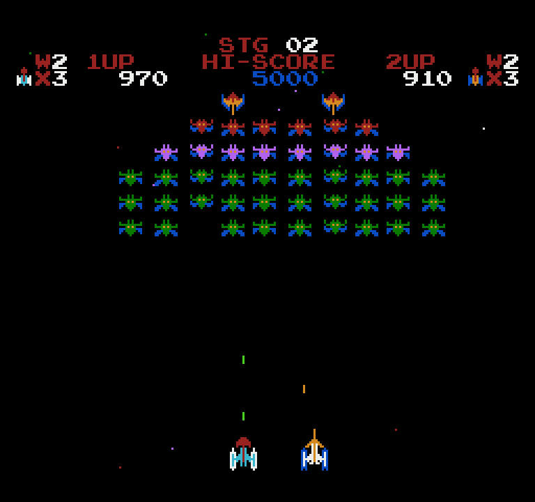
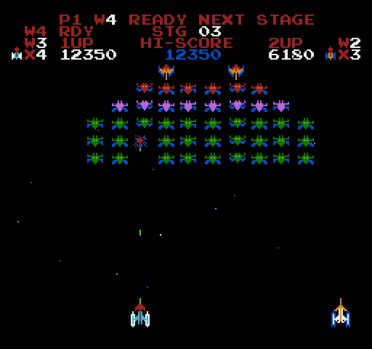
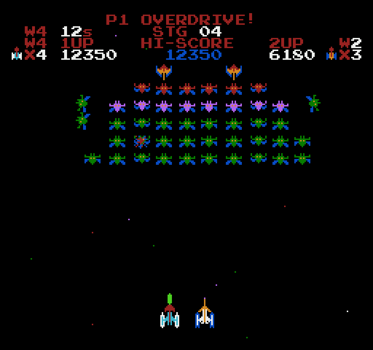
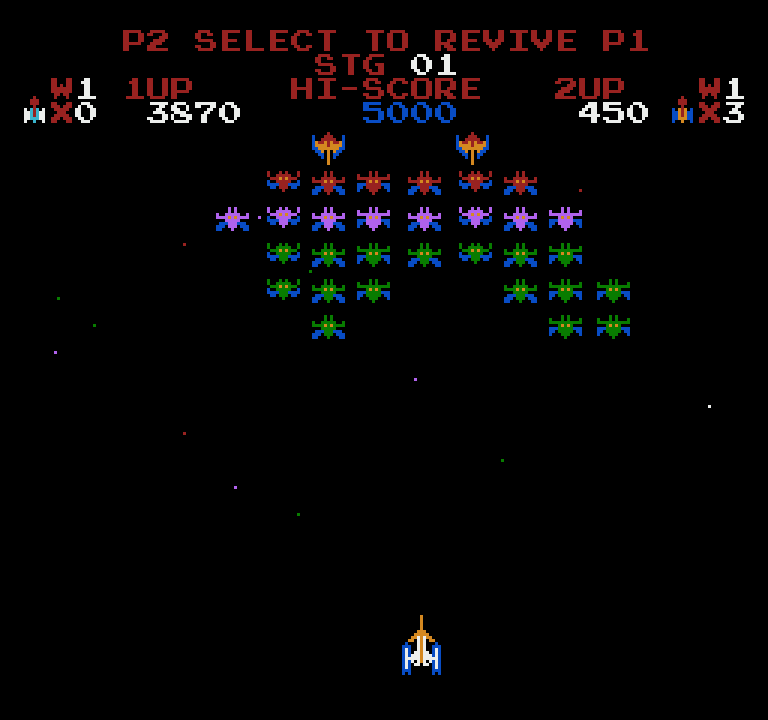
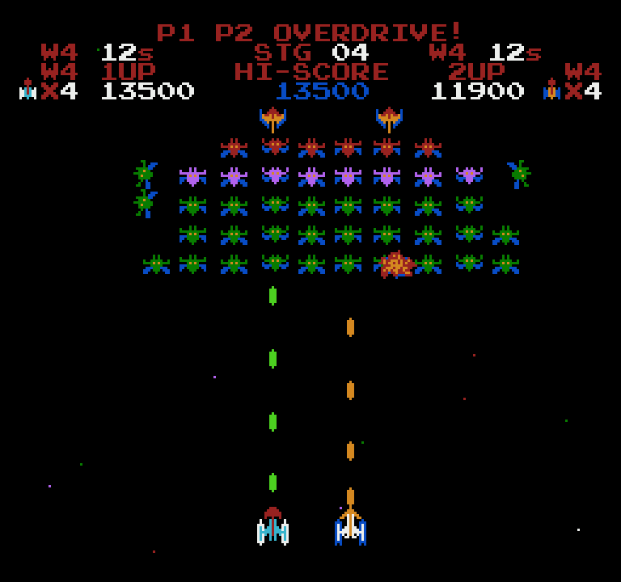

[English](README.md) | **Polski**

<p align="center">
  
</p>

<p align="center">
  <a href="#zrzuty-ekranu">Zrzuty</a> ·
  <a href="#zasady">Zasady</a> ·
  <a href="#sterowanie">Sterowanie</a> ·
  <a href="#instalacja">Instalacja</a> ·
  <a href="#uruchomienie-w-emulatorze">Emulatory</a> ·
  <a href="#znane-ograniczenia">Ograniczenia</a> ·
  <a href="#dokumentacja">Dokumentacja</a>
</p>

**Galaxian Coop** to nieoficjalna modyfikacja gry *Galaxian* (Namco, NES/Famicom 1984), w której
**dwóch graczy walczy z formacją obcych jednocześnie** – inspirowana Galaxian DX na Commodore 64. Wygląd
i charakter oryginału zostają; modyfikacja dodaje drugi statek, poziomy broni z czasowym **Red Laser
Overdrive**, tarczę po odrodzeniu, dzielenie się życiami, dodatkowe życia i licznik etapów. **1 PILOT**
gra według dokładnie tych samych zasad, co każdy pilot w **2 PILOTS CO-OP**.

Stan: release candidate 6 (RC6) · mapper 0 · SHA-256 ROM-u `7e5d4fd1…` · testy automatyczne
w emulatorach ([docs/TESTING.md](docs/TESTING.md), po angielsku).

## Zrzuty ekranu

| Dwóch pilotów | Jeden pilot |
|---|---|
|  |  |
| **Ekran tytułowy** | **Wzmocnienie broni: W2 dla obu po etapie 1** |
|  |  |

**Overdrive: READY w jednym etapie, ACTIVE w następnym**

| W4 READY (etap 3) | W4 ACTIVE (początek etapu 4) |
|---|---|
|  |  |
| Punkty przygotowały overdrive; do końca etapu nic się nie zmienia. | Nowa formacja jest na ekranie: W4 przez 12 s, punkty ×2, trzech obcych atakuje od razu. |

| Dzielenie się życiami | Obaj piloci w overdrive |
|---|---|
|  |  |

Wszystkie obrazy to klatki ROM-u RC6 w emulatorze cynes (×3, bez filtrów), wygenerowane skryptami
testowymi projektu ze sterowaniem skryptowym. Na zrzutach READY/ACTIVE i z oboma pilotami w overdrive
skrypty ustawiły w RAM wynik, życia, etap i poziom broni na wartości osiągalne w normalnej grze; sam READY
pochodzi z prawdziwego zestrzelenia, a overdrive ze startu etapu wykonanego przez grę
([szczegóły](docs/TESTING.md#screenshots)).

## Zasady

Zasady są takie same dla każdego pilota w obu trybach. Tylko drugi statek, dzielenie się życiami
i warunek końca gry zależą od obecności dwóch graczy.

### Poziomy broni

| Poziom | Strzały naraz | Prędkość strzału | Jak zdobyć |
|---|---:|---:|---|
| **W1** | 1 | 100 % | początek gry; po śmierci, jeśli W2 nigdy nie zostało odblokowane |
| **W2** | 2 | 110 % | **za darmo raz na grę za ukończenie pierwszego etapu**; w przeciwnym razie 2000 punktów, potem ukończony etap |
| **W3** | 3 | 120 % | kolejne 4000 punktów po W2, potem ukończony etap |
| **W4** | 4 lasery | 160 % | Red Laser Overdrive – zob. niżej |

- Jedno nowe wciśnięcie FIRE = jeden strzał, o ile jest wolny strzał; przytrzymanie FIRE nie strzela
  ponownie.
- Punkty do W2/W3 liczą się od nowa po przyznaniu poziomu; ukończony etap daje najwyżej jeden poziom.
- Darmowe W2 dostaje też pilot, który w tym momencie eksploduje lub czeka na kolejny statek; pilot
  trafiony na ostatnim statku go nie dostaje.
- **W2 zostaje po odblokowaniu**: po śmierci pilot wraca na W2 (W1, jeśli nigdy go nie odblokował).
  Postęp do W3, punkty od ostatniej śmierci i overdrive są zerowane; wynik i progi dodatkowych żyć
  zostają.

### Red Laser Overdrive (W4)

| | **W4 READY** | **W4 ACTIVE** |
|---|---|---|
| Kiedy | na W3, po 8000 punktów bez śmierci (raz na życie) | na początku **następnego** etapu, gdy tylko jego formacja zostanie narysowana (ok. 21 klatek ≈ 0,35 s po starcie etapu) |
| Broń | nadal W3 | 4 lasery z prędkością 160 %, dźwięk lasera |
| Punkty | ×1 | **×2** za własne zestrzelenia pilota (liczą się do dodatkowych żyć i rekordu) |
| Wrogowie | normalnie | **kontratak**: trzech obcych opuszcza formację w tej samej klatce i nurkuje na pilota; potem ok. 60–80 % więcej startów ataku, nurkowanie ok. 23 % szybsze, trzy na cztery cele ataku i większość strzałów wroga skierowane na tego pilota, jeden strzał więcej na atak |
| HUD | `OVERDRIVE READY NEXT STAGE` (1 PILOT) lub `P1 W4 READY NEXT STAGE` (co-op) przez 2 s; `W4 RDY` nad wynikiem | melodia, `OVERDRIVE!` (`P1 OVERDRIVE!`, `P1 P2 OVERDRIVE!` …), odliczanie `W4 12s` … `W4 01s` |
| Koniec | śmierć go anuluje | po **12 sekundach gry** (720 klatek; pauza i zmiana etapu się nie liczą) → powrót na W3, ×1, normalni wrogowie; lecące lasery dolatują do końca |

Każdy pilot ma własny READY, odliczanie i jedno użycie na życie. Ożywienie przez SELECT nie przywraca
anulowanego overdrive. Gdy obaj piloci startują w tym samym etapie, ataki dzielą się między nich – dwa
overdrive się nie sumują. W grze lasery mają kolor pilota (zielony P1, pomarańczowy P2).

### Życia, tarcza i etapy

- **Życia**: każdy pilot zaczyna z `X3` (wliczając statek w grze). **Dodatkowe życie** co 7000 punktów
  (7000, 14000, 21000 …), maksymalnie 9.
- **Tarcza po odrodzeniu** (Respawn Shield): 4 sekundy nietykalności po każdym odrodzeniu i po
  ożywieniu przez SELECT, w obu trybach; statek miga (szybciej w ostatniej sekundzie), porusza się
  i strzela. Brak tarczy na starcie gry i przy zmianie etapu.
- **Licznik etapów** `STG 01`, `STG 02` … nad rekordem, w obu trybach (1 PILOT zachowuje też oryginalne
  flagi etapów).

### Tylko dla dwóch pilotów

- **Dwa statki**: P1 (kontroler 1) leci oryginalnym statkiem (czerwona kopuła, biało-błękitne gondole)
  z **jaskrawozielonymi** strzałami; P2 (kontroler 2) leci własnym pomarańczowo-niebieskim statkiem
  (delta, biały kokpit) z **pomarańczowymi** strzałami. Ten sam rozmiar i obszar trafienia; statki mogą
  przez siebie przelatywać.
- Osobne wyniki i życia; punkty trafiają do pilota, który strzelił; strzały wrogów i nurkujący obcy mogą
  trafić każdy statek; ataki są kierowane na pilotów na zmianę.
- **Dzielenie się życiami** (Life Sharing): gdy jeden pilot odpadł (`X0`), a drugi jest w grze i ma co
  najmniej `X2`, ten drugi wciska **SELECT**, by oddać statek: dawca −1 życie i +200 punktów, odbiorca
  wraca z 1 życiem i tarczą. Linia komunikatów mówi, kto może wcisnąć SELECT.
- **Koniec gry** dopiero, gdy odpadną obaj piloci; pozostały pilot gra dalej.

## Sterowanie

| Akcja | Gracz 1 | Gracz 2 |
|---|---|---|
| Ruch | D-pad lewo / prawo | D-pad lewo / prawo |
| Strzał | A lub B | A lub B |
| Oddanie statku (co-op) | SELECT | SELECT |
| Pauza | START | – |
| Ekran tytułowy: wybór trybu / start | SELECT / START | – |

SELECT oddaje statek tylko w grze co-op, w normalnej rozgrywce, przy nowym wciśnięciu i gdy pozwala na
to powyższa zasada; w innych sytuacjach nic nie robi. Przycisk FIRE przytrzymany podczas powrotu statku
trzeba najpierw puścić.

## Instalacja

Potrzebny jest własny ROM *Galaxian* (Japonia) i Python 3 (testowane 3.14, Linux). Polecenia uruchamia
się z katalogu głównego repozytorium.

| Wymagany ROM | |
|---|---|
| Plik | `Galaxian (Japan).nes`, 16 400 bajtów, nagłówek NES 2.0, mapper 0 |
| SHA-256 | `1188cedf84657769f19daef474d9a20e7c2d16f9c5c5998d5baab59f74f3613e` |
| CRC32 | `8451DC60` (cały plik), `084F61CD` (bez nagłówka) |

Galaxian (USA) i zrzuty bez nagłówka to inne pliki – są odrzucane.

**A – nałożenie łatki BPS**

```bash
python3 tools/bps.py apply "Galaxian (Japan).nes" games/galaxian-coop/patches/Galaxian_Coop.bps "Galaxian Coop.nes"
sha256sum "Galaxian Coop.nes"
# 7e5d4fd1ee57fd0dba4901a37002b024bee4f8987bf471b8d7341b9c0ea232ca
```

Działa każde narzędzie BPS (Flips, Rom Patcher JS, beat). Łatka sprawdza CRC32 źródła i wyniku.

**B – budowanie ze źródeł**

```bash
mkdir -p games/galaxian-coop/private
cp "Galaxian (Japan).nes" games/galaxian-coop/private/
python3 games/galaxian-coop/src/build.py
sha256sum games/galaxian-coop/build/Galaxian_Coop.nes
# 7e5d4fd1ee57fd0dba4901a37002b024bee4f8987bf471b8d7341b9c0ea232ca
```

Build sprawdza wejście, asembluje `src/asm/coop.asm` własnym asemblerem 6502 repozytorium, nakłada
zaczepy w kodzie (sprawdzając każdy zastępowany bajt oryginału), zmiany CHR i palety, kontroluje użycie
RAM i zapisuje `build/Galaxian_Coop.nes` oraz etykiety debuggera Mesen 2 `build/Galaxian_Coop.mlb`.
Opcje: `-o PLIK`, `--bps` (przepisuje też łatkę). Dwa buildy dają identyczne bajty; błędy przerywają
budowanie z kodem 1. Jak działają zaczepy: [docs/REVERSE_ENGINEERING.md](docs/REVERSE_ENGINEERING.md).

## Uruchomienie w emulatorze

Wynik to zwykły ROM NES z mapperem 0: uruchomisz go w Mesen 2, FCEUmm (samodzielnie lub jako rdzeń
RetroArch), Nestopii, FCEUX lub innym emulatorze NES. Do **2 PILOTS CO-OP** przypisz różne urządzenia
graczowi 1 i 2 (RetroArch: Settings → Input → *Port 1 Controls* / *Port 2 Controls*) i podłącz oba
kontrolery przed startem gry.

Testy: automatyczne w emulatorze cynes, rdzeniu FCEUmm (przez `stable-retro`) i tracerze 6502; ręczne
w emulatorze. Nie testowano: Mesen 2, innych emulatorów i rdzeni, prawdziwego sprzętu NES/Famicom.

## Znane ograniczenia

- **Limit sprite'ów**: NES pokazuje najwyżej 8 sprite'ów w linii; przy wielu nurkujących obcych,
  strzałach i statku P2 w jednej linii sprite może zniknąć na klatkę (nie zaobserwowano w testach
  automatycznych).
- **Budżet CPU**: z oboma pilotami w overdrive gra działa blisko limitu klatki; aby się zmieścić, na
  klatkę przetwarzane jest najwyżej jedno trafienie (drugie klatkę później), kolizje P2 sprawdzane są co
  drugą klatkę, przechył nurkujących obcych aktualizowany z częstotliwością 30 Hz, a HUD odświeżany przez
  kilka klatek. Nie zmierzono spowolnień.
- Gdy P1 traci statek, nowe fale ataku czekają na jego powrót (jak w oryginale); śmierci P2 tego nie
  wstrzymują. Otwierający atak overdrive jest pomijany, jeśli P1 zostanie trafiony dokładnie w tym
  momencie.
- Kontratak używa własnych ataków gry: obcy lecą swoim zwykłym łukiem startowym (~0,8 s), zanim skręcą
  w dół. Odliczanie pojawia się klatkę po komunikacie `OVERDRIVE!`, cyfra `Wn` kilka klatek później.
- 2 piksele nurkującego fioletowego obcego są zielone zamiast pomarańczowych (brak wolnego koloru dla
  strzałów P1); statek P1 ma oryginalne kolory (dzieli paletę z HUD).
- Komunikaty są czerwone i krótkie (pola HUD po 6 znaków, linia komunikatów 26 znaków); 13 gwiazd zamiast
  24.

## Rozwiązywanie problemów

| Problem | Co zrobić |
|---|---|
| `input is not Galaxian (Japan) [SHA-256 mismatch]` | Zły zrzut lub wersja – użyj ROM-u o podanym SHA-256. |
| `original ROM not found: …` | Skopiuj ROM do `games/galaxian-coop/private/` lub podaj ścieżkę: `build.py ŚCIEŻKA/rom.nes`. |
| BPS: `source ROM CRC mismatch` / `patch CRC mismatch` | Zły ROM źródłowy albo uszkodzony `.bps` – przywróć go: `git checkout -- games/galaxian-coop/patches`. |
| `.patch $XXXX: original bytes … != …` | ROM źródłowy nie jest oczekiwanym plikiem albo `coop.asm` zmieniono niespójnie. |
| Inny hash wyniku | Build jest deterministyczny: sprawdź hash wejścia i `git status`. |
| `ModuleNotFoundError` | Uruchamiaj `python3` wewnątrz repozytorium; `tools/` musi leżeć obok `games/`. |
| Gracz 2 nie reaguje | Przypisz urządzenie do portu 2; P2 używa kontrolera **2**. |

## Dokumentacja

| Dokument | Zawartość |
|---|---|
| [docs/TESTING.md](docs/TESTING.md) | uruchamianie testów, aktualne wyniki, katalog testów, pomiary, lista testów ręcznych (EN) |
| [docs/CHANGELOG.md](docs/CHANGELOG.md) | każda wersja z sumą kontrolną ROM-u (EN) |
| [docs/REVERSE_ENGINEERING.md](docs/REVERSE_ENGINEERING.md) | jak działa oryginalna gra, każdy zaczep, decyzje projektowe (EN) |
| [docs/MEMORY_MAP.md](docs/MEMORY_MAP.md) | użycie ROM, RAM, OAM, CHR i nametable (EN) |
| [docs/IMPLEMENTATION_REPORT.md](docs/IMPLEMENTATION_REPORT.md) | raport z prac dla każdego release candidate (PL; zasady RC1–RC5 nieaktualne) |
| [docs/history/](docs/history/) | historia testów sprzed RC6, notatki z etapu 1, mapa połączonych commitów |

## Prawa i autorzy

- **Galaxian Coop – Zvgelo (2026)**: cały nowy kod, zmiany grafiki, narzędzia, testy i dokumentacja; nie
  użyto innych hacków. Udostępnione na [licencji MIT](../../LICENSE).
- Licencja MIT nie obejmuje samej gry *Galaxian* – © Namco (automat 1979, NES/Famicom 1984), jej ROM-u,
  grafiki i dźwięku, cytowanych w miejscach zaczepów bajtów oryginalnego programu ani oryginalnej grafiki
  widocznej na zrzutach ([THIRD_PARTY_NOTICES](../../THIRD_PARTY_NOTICES.md)). Oryginalne napisy autorskie
  zostają na ekranie tytułowym.
- Nieoficjalna modyfikacja fanowska, niepowiązana z Bandai Namco i przez nią nieautoryzowana. Repozytorium
  nie zawiera ROM-u.
