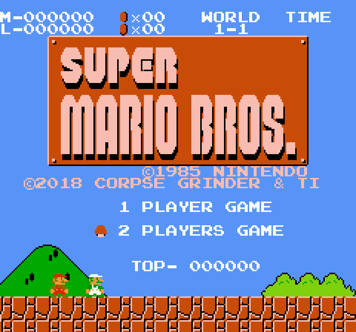
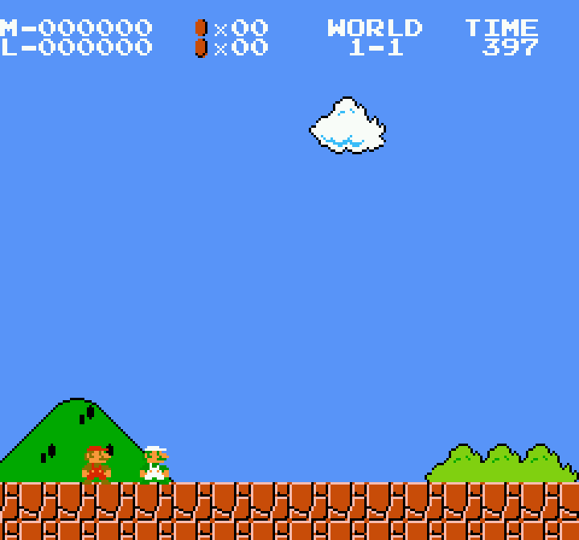
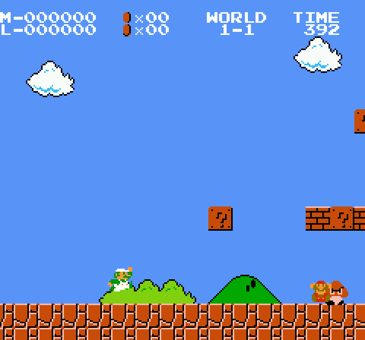

[English](README.md) | **Polski**

# Super Mario Bros. Two Players Hack – zestaw do budowania

Mario i Luigi na ekranie **jednocześnie**, każdy sterowany własnym kontrolerem. Gra to
**Super Mario Bros. Two Players Hack autorstwa Corpse Grinder i Ti (2018)**. Ten katalog pomaga jedynie
zbudować ją w powtarzalny sposób z własnego ROM-u *Super Mario Bros.* i oryginalnej łatki hacka, którą
pobierasz z wydania autorów – nie ma jej w repozytorium (zob.
[Autorzy oryginalnego hacka i prawa autorskie](#autorzy-oryginalnego-hacka-i-prawa-autorskie)).

<p align="center">
  
</p>

## Kto co zrobił

> **Super Mario Bros. – Two Players Hack. Oryginalny hack: Corpse Grinder & Ti (2018).**
> Gra, jej tryb kooperacji i łatka są ich dziełem; ich podpis zostaje na ekranie tytułowym
> (`©2018 CORPSE GRINDER & TI`). Ten projekt nie modyfikuje hacka i nie dodaje do niego żadnego podpisu.

| | Two Players Hack (Corpse Grinder i Ti, 2018) | Ten katalog (Zvgelo, 2026, MIT) |
|---|---|---|
| Kooperacja: Luigi razem z Mario, drugi kontroler | ✔ | – |
| Łatka `.xdelta` | ✔ (nie ma jej tutaj – pobierz z wydania autorów) | – |
| Budowanie jednym poleceniem z kontrolą SHA-256, dekoder xdelta/VCDIFF w Pythonie, testy, dokumentacja | – | ✔ |

Zbudowany ROM jest bajt w bajt ROM-em Two Players Hack (SHA-256 `e962eee2…`), tym samym, co wynik
`xdelta3`.

## Zrzuty ekranu

| Poziom 1-1, obaj gracze | Niezależny ruch |
|---|---|
|  |  |

Klatki zbudowanego ROM-u w rdzeniu FCEUmm (przez `stable-retro`), sterowane dwoma wirtualnymi
kontrolerami, ×3 bez filtrów. Grafika należy do Nintendo i autorów hacka (zob.
[THIRD_PARTY_NOTICES](../../THIRD_PARTY_NOTICES.md)).

## Jak uzyskać grę

Potrzebne są dwa pliki, których to repozytorium **nie** zawiera, oraz Python 3 (testowane 3.14, Linux).
Polecenia uruchamia się z katalogu głównego repozytorium.

| Wejście | |
|---|---|
| Własny ROM | `Super Mario Bros. (World).nes`, 40 976 bajtów, iNES 1.0, mapper 0 |
| jego SHA-256 | `f61548fdf1670cffefcc4f0b7bdcdd9eaba0c226e3b74f8666071496988248de` |
| jego CRC32 | `3337EC46` (cały plik), `D445F698` (bez nagłówka) |
| Łatka hacka | `Super Mario Bros. (Two Players Hack).xdelta`, 19 395 bajtów, z wydania autorów: [wątek Emu-Land](https://www.emu-land.net/forum/index.php?topic=81090.0) autorstwa Ti_ (13.10.2018), załącznik `Super Mario Bros. (Two Players Hack).7z` |
| jej SHA-256 | `d38048c3ea96aabf2d4162d446ced3268681e2f0915a0c828d9363934371cffd` |

Wynik to ROM z **mapperem 24 (Konami VRC6a)** (64 KiB PRG, 8 KiB CHR), zgodnie z nagłówkiem hacka.

**A – jedno polecenie (zalecane)**

```bash
mkdir -p games/super-mario-coop/private
cp "Super Mario Bros. (World).nes" games/super-mario-coop/private/original.nes
cp "Super Mario Bros. (Two Players Hack).xdelta" games/super-mario-coop/private/
python3 games/super-mario-coop/src/build.py
sha256sum "games/super-mario-coop/build/Super Mario Bros. (Two Players Hack).nes"
# e962eee2c23449070ebd599357570cfc9da9586e21f142596f49b1eb8c691dd4
```

`src/build.py` sprawdza oryginał i łatkę, nakłada łatkę przez `tools/vcdiff.py` (albo programem
`xdelta3` z opcją `--xdelta3` – te same bajty) i sprawdza wynik. Opcje: `--patch PLIK` (łatka w innym
miejscu), `-o PLIK`. Bez łatki build zatrzymuje się i podaje, skąd ją pobrać; łatka o innym SHA-256 jest
odrzucana. Każdy nieudany test kończy pracę kodem 1; pliki wejściowe nie są nigdy zapisywane. Oba miejsca
na pliki wejściowe są ignorowane przez git (`private/`, `*.xdelta`).

**B – dowolne narzędzie xdelta**

```bash
xdelta3 -d -s "Super Mario Bros. (World).nes" "Super Mario Bros. (Two Players Hack).xdelta" \
    "Super Mario Bros. (Two Players Hack).nes"
# albo bez xdelta3:
python3 tools/vcdiff.py "Super Mario Bros. (World).nes" "Super Mario Bros. (Two Players Hack).xdelta" \
    "Super Mario Bros. (Two Players Hack).nes"
sha256sum "Super Mario Bros. (Two Players Hack).nes"
# e962eee2c23449070ebd599357570cfc9da9586e21f142596f49b1eb8c691dd4
```

## Sterowanie

| | Kontroler 1 | Kontroler 2 |
|---|---|---|
| Postać | Mario | Luigi |
| Ruch | D-pad | D-pad |
| Skok / pływanie | A | A |
| Bieg / kula ognia | B | B |
| Pauza | START | – |

Na ekranie tytułowym SELECT (kontroler 1) wybiera **1 PLAYER GAME** lub **2 PLAYERS GAME**; START
uruchamia grę. Do kooperacji wybierz **2 PLAYERS GAME**.

## Uruchomienie w emulatorze

ROM wymaga emulatora z obsługą **mappera 24**, np. FCEUmm (samodzielnie lub jako rdzeń RetroArch),
Mesen 2, Nestopia lub FCEUX. Przypisz różne urządzenia graczowi 1 i 2 (RetroArch: Settings → Input →
*Port 1 Controls* / *Port 2 Controls*) i podłącz oba kontrolery przed startem.

## Ograniczenia

- Testowane tylko w rdzeniu FCEUmm przez `stable-retro` (ekran tytułowy i oba kontrolery, zob.
  [docs/TESTING.md](docs/TESTING.md)). Nie testowano: samego RetroArch, Mesen 2, innych emulatorów,
  sprzętu, dźwięku, kolizji między graczami, śmierci i restartu poziomu, dalszych poziomów.
- Zachowanie kooperacji w całości pochodzi z Two Players Hack; pytania o nie należą do jego autorów.
- Emulator bez mappera 24 pokaże czarny ekran lub błędną grafikę.

## Rozwiązywanie problemów

| Problem | Co zrobić |
|---|---|
| `input is not Super Mario Bros. (World) [SHA-256 mismatch]` | Zły zrzut lub wersja – użyj ROM-u o podanym SHA-256. |
| `original ROM not found: …` | Skopiuj ROM do `games/super-mario-coop/private/original.nes` lub podaj ścieżkę: `build.py ŚCIEŻKA/rom.nes`. |
| `patch not found: …` | Pobierz wydanie autorów, umieść `.xdelta` w `games/super-mario-coop/private/` lub podaj `--patch ŚCIEŻKA`. |
| `….xdelta: unexpected SHA-256` | Zmieniony lub uszkodzony plik albo inne wydanie – użyj niezmienionej łatki o podanym SHA-256. |
| `xdelta3 not found` | Tylko z `--xdelta3`: zainstaluj `xdelta3` lub pomiń opcję. |
| Czarny ekran, zła grafika | Emulator nie obsługuje mappera 24 – użyj innego. |
| Gracz 2 nie reaguje | Przypisz urządzenie do portu 2 i podłącz drugi kontroler przed startem. |

## Testy

```bash
pip install -r games/super-mario-coop/tests/requirements.txt    # stable-retro, numpy (testy w emulatorze)
python3 games/super-mario-coop/tests/test_build.py -v           # wszystkie 16: 14 plików/budowania + 2 w emulatorze
python3 games/super-mario-coop/tests/test_emulator.py -v        # tylko 2 testy w emulatorze (FCEUmm)
```

Testy ROM-ów potrzebują oryginału i łatki w `private/` (albo ścieżek w `SMB_ORIGINAL` i `SMB_XDELTA`);
bez nich działają tylko 4 testy plików. Wyniki: [docs/TESTING.md](docs/TESTING.md) (po angielsku). Historia: [docs/CHANGELOG.md](docs/CHANGELOG.md).

## Autorzy oryginalnego hacka i prawa autorskie

*Super Mario Bros. – Two Players Hack* stworzyli **Corpse Grinder i Ti (2018)**.

To repozytorium nie jest twórcą hacka i nie przypisuje sobie autorstwa jego trybu kooperacji, oryginalnych
modyfikacji ani łatki.

Łatka **nie jest rozpowszechniana** w tym repozytorium. Jest przypisana jej twórcom i dostępna w ich
własnym wydaniu ([wątek Emu-Land](https://www.emu-land.net/forum/index.php?topic=81090.0)); repozytorium zapisuje jedynie jej SHA-256 (`d38048c3ea96aabf2d4162d446ced3268681e2f0915a0c828d9363934371cffd`) i nakłada
ją lokalnie. **Nie** obejmuje jej [licencja MIT](../../LICENSE); nie twierdzimy, że mamy od twórców
licencję ani zgodę na redystrybucję.

*Super Mario Bros.* i oryginalne zasoby gry pozostają własnością intelektualną ich właścicieli (© Nintendo,
1985). To nieoficjalny projekt fanowski, niepowiązany z Nintendo i przez nie nieautoryzowany. Repozytorium
nie zawiera ROM-ów.

Właściciele praw, którzy mają zastrzeżenia do materiałów w tym repozytorium, mogą skontaktować się z opiekunem
repozytorium przez GitHub, np. zakładając zgłoszenie (Issue) w tym repozytorium. Uzasadnione żądania zostaną
rozpatrzone.

**Własna część repozytorium – Zvgelo (2026)**: skrypt budujący, dekoder VCDIFF, testy i dokumentacja, na
[licencji MIT](../../LICENSE). Szczegóły: [THIRD_PARTY_NOTICES](../../THIRD_PARTY_NOTICES.md).
